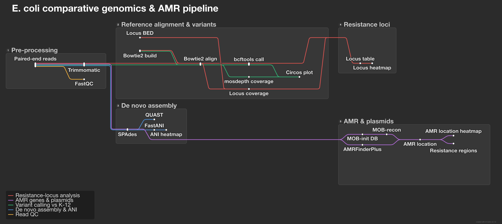

# Comparing E.Coli Species and Identifying Antimicrobial Resistance Genes
**Kenneth Ofori-Amanfo**

## Introduction
Antibiotics have played a cruicial role in improving health care and human longevity. However, excessive use of antibiotics have contributed to the spread of antibiotic resistance ([(Baquero et al. 2021](https://pmc.ncbi.nlm.nih.gov/articles/PMC8141826/)). A relevant situation is *Escherichia coli*, which affects healthcare systems worldwide ([Walker et al. 2022](https://pubmed.ncbi.nlm.nih.gov/36551478/)). Multi-drug resistance has spread through *E. coli* populations, causing β-lactam antibiotics, fluoroquinolones, aminoglycosides, and trimethoprim-sulfamethoxazole to be less effective. Drug-resistance strains are often associated with hospital settings and can spread through wastewater systems ([Mannan et al. 2024](https://pubmed.ncbi.nlm.nih.gov/38274770/), [Męcik et al. 2024)](https://pubmed.ncbi.nlm.nih.gov/39052110/#full-view-affiliation-1)). One of the ways antimicrobial resistance (AMR) spreads are through mobile genetic elements (MGE) such as plasmids and integrative conjugative elements ([Partidge et al. 2018](https://pubmed.ncbi.nlm.nih.gov/30068738/)). Monitoring resistant bacteria and understanding antibiotic resistance mechanisms will improve AMR prevention measures and potentially identify new novel treatment methods.

This workflow allows for intial general analysis of short-read sequencing data *E. coli* species, performing the following:
1) Provide a fast quality check report using FASTQC. Use Trimmomatic to filter low-quality bases and remove adapter sequences
2) Align Trimmomatic output reads against the *K-12 E. coli* strain
3) Create visualization for K-12 comparisons and identify Resistant loci
4) Use Trimmomatic output reads to create de novo assemblies to compare genomic similarities
5) Identify AMR and plasmids



## Compute requirements
Recommended requirements based on Claude Opus 5.5 estimates:
- CPUs = 8
- Memory = 16

Minimum requirements:
- CPUs = 2
- Memory = 6 GB

## Dependencies
The workflow uses Nextflow as its management system. Please install [Nextflow](https://www.nextflow.io/) to run the workflow.

Required software is obtained with [Docker](https://docs.docker.com/learn/). Please also have it installed.

## Fetch Sample Data and Run

Once all dependencies are installed, you can test the workflow by following the following instructions which provides data from [Mannan et al. 2024](https://pubmed.ncbi.nlm.nih.gov/38274770/).

To download the k12 reference file run the following script
```
 bash bin/download_k12_reference.sh
```
The reads for the four resistant *E. coli* isolates are downloaded by the pipeline itself (`DOWNLOAD_READS`) and saved to `data/reads/` as `<sample>_{1,2}.fastq.gz`:

| Sample | SRA run |
|--------|---------|
| PG1BP  | SRR33692911 |
| DMIH   | SRR33692910 |
| HCDL   | SRR33692909 |
| NTIH   | SRR33692908 |

If those files are already present, the download is skipped.

**Run the Pipeline**
```
nextflow run main.nf -profile local -w work_bench -resume
```

### AI Disclosure
This workflow uses LLM tools in its development. Code development and creation of directed acyclic graph: Claude Opus 5.5.