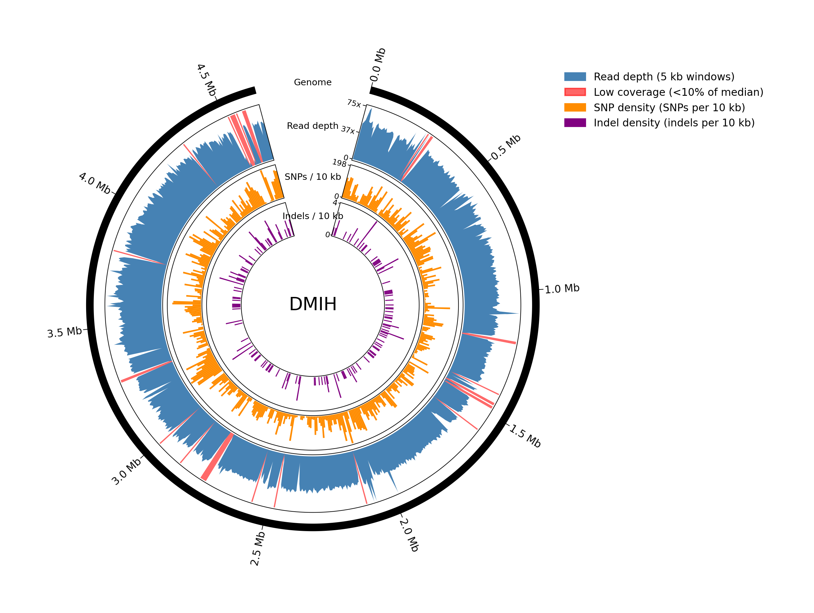

# Comparing *E. coli* Strains and Identifying Antimicrobial Resistance Genes (CESAR)
**Kenneth Ofori-Amanfo**

## Introduction
Antibiotics have played a crucial role in improving health care and human longevity. However, excessive use of antibiotics has contributed to the spread of antibiotic resistance [[1](https://doi.org/10.1007/s10123-021-00184-y)]. A relevant situation is *Escherichia coli*, which affects healthcare systems worldwide [[2](https://doi.org/10.3390/antibiotics11121821)]. Multi-drug resistance has spread through *E. coli* populations, causing β-lactam antibiotics, fluoroquinolones, aminoglycosides, and trimethoprim-sulfamethoxazole to be less effective. Drug-resistant strains are often associated with hospital settings and can spread through wastewater systems [[3](https://doi.org/10.3389/fmicb.2023.1292597), [4](https://doi.org/10.1007/s11356-024-34436-x)]. One of the ways antimicrobial resistance (AMR) spreads is through mobile genetic elements (MGEs) such as plasmids and integrative conjugative elements [[5](https://doi.org/10.1128/CMR.00088-17)]. Monitoring resistant bacteria and understanding antibiotic resistance mechanisms will improve AMR prevention measures and potentially identify novel treatment methods.

Mannan et al. [[6](https://doi.org/10.1186/s12864-026-12873-x)] have previously investigated *E. coli* strains isolated from hospital wastewater. They identified four AMR strains and profiled their genomes, including both chromosome and plasmids, using short-read and long-read sequencing. Despite their findings of AMR genes in these bacterial strains and insightful comparisons between strains, they did not share their code or publish their long-read data. My goal was to create a publicly available workflow built on widely used methods, focusing on short-read sequencing. The workflow uses the same four strains as Mannan et al. [[6](https://doi.org/10.1186/s12864-026-12873-x)], which are available via the [NCBI Sequence Read Archive](https://www.ncbi.nlm.nih.gov/sra).

This workflow, CESAR, allows for an initial general analysis of short-read sequencing data from *E. coli* isolates.


1) The [`SRA Toolkit`](https://github.com/ncbi/sra-tools) [[7](https://github.com/ncbi/sra-tools)] downloads the reads. [`FastQC`](https://github.com/s-andrews/fastqc) [[8](https://www.bioinformatics.babraham.ac.uk/projects/fastqc/)] provides a read quality report, and [`Trimmomatic`](https://github.com/usadellab/trimmomatic) [[9](https://doi.org/10.1093/bioinformatics/btu170)] filters low-quality bases and removes adapter sequences.
2) [`Bowtie2`](https://github.com/benlangmead/bowtie2) [[10](https://doi.org/10.1038/nmeth.1923)] aligns the trimmed reads to the *E. coli* K-12 reference genome (RefSeq [GCF_000005845.2](https://www.ncbi.nlm.nih.gov/datasets/genome/GCF_000005845.2/), ASM584v2) [[11](https://doi.org/10.1126/science.277.5331.1453)], and [`SAMtools`](https://github.com/samtools/samtools) [[12](https://doi.org/10.1093/gigascience/giab008)] sorts and indexes the alignments.
3) [`mosdepth`](https://github.com/brentp/mosdepth) [[13](https://doi.org/10.1093/bioinformatics/btx699)] and [`BCFtools`](https://samtools.github.io/bcftools/bcftools.html) [[12](https://doi.org/10.1093/gigascience/giab008)] measure coverage and call variants against K-12. These are visualized with [`pyCirclize`](https://moshi4.github.io/pyCirclize/) [[14](https://github.com/moshi4/pyCirclize)] circos plots and a heatmap of known resistance loci (porins, efflux pumps, drug targets).
4) [`SPAdes`](https://github.com/ablab/spades) [[15](https://doi.org/10.1002/cpbi.102)] builds de novo assemblies from the trimmed reads. [`QUAST`](https://github.com/ablab/quast) [[16](https://doi.org/10.1093/bioinformatics/btt086)] assesses assembly quality and [`FastANI`](https://github.com/ParBliSS/FastANI) [[17](https://doi.org/10.1038/s41467-018-07641-9)] compares genomic similarity between isolates.
5) [`AMRFinderPlus`](https://www.ncbi.nlm.nih.gov/pathogens/antimicrobial-resistance/AMRFinder/) [[18](https://doi.org/10.1038/s41598-021-91456-0)] identifies AMR genes in the assemblies, and [`MOB-suite`](https://github.com/phac-nml/mob-suite) [[19](https://doi.org/10.1099/mgen.0.000206), [20](https://doi.org/10.1099/mgen.0.000435)] determines whether each one is located on a plasmid or the chromosome.

## Main Dependencies
The workflow uses Nextflow [[21](https://doi.org/10.1038/nbt.3820)] as its management system. Please install [Nextflow](https://www.nextflow.io/) to run the workflow.

Required software is obtained with [Docker](https://docs.docker.com/learn/). Please also have it installed.

- SRA Toolkit=3.2.1
- FastQC=0.12.1
- Trimmomatic=0.39
- Bowtie2=2.5.2
- SAMtools=1.18
- mosdepth=0.3.14
- BCFtools=1.25
- SPAdes=4.3.0
- QUAST=5.3.0
- FastANI=1.34
- AMRFinderPlus=4.2.7
- MOB-suite=3.1.9
- pyCirclize=1.10.1

## Compute requirements
Based on Claude Opus 5.5 estimates

Recommended requirements:
- CPUs = 8
- Memory = 16 GB

Each task is capped at 6 CPUs and 8 GB (`resourceLimits` in `nextflow.config`); raise these to make use of a larger machine.

Minimum requirements:
- CPUs = 2
- Memory = 6 GB

## Usage

Once all dependencies are installed, you can test the workflow with the instructions below, which use data from Mannan et al. [[6](https://doi.org/10.1186/s12864-026-12873-x)].

**Clone repository**
```
git clone https://github.com/KennethOfori/biof501project-CESAR.git
cd biof501project-CESAR
```

The reads for the four resistant *E. coli* isolates are downloaded by the pipeline itself (`DOWNLOAD_READS`) and saved to `data/reads/` as `<sample>_{1,2}.fastq.gz`:

| Sample | SRA run |
|--------|---------|
| PG1BP  | SRR33692911 |
| DMIH   | SRR33692910 |
| HCDL   | SRR33692909 |
| NTIH   | SRR33692908 |

These runs are available from the NCBI Sequence Read Archive under BioProject [PRJNA1267524](https://www.ncbi.nlm.nih.gov/bioproject/PRJNA1267524).

If those files are already present, the download is skipped.

**Run the Pipeline**
```
nextflow run main.nf -profile local -w work -resume
```
## Results
After running the pipeline you can verify that everything worked by comparing the generated output with the contents of `expected_results/`. The full table of AMR genes found in each isolate is in `expected_results/amrfinder_summary.tsv`.

**Circos plot sample DMIH:**



**Average Nucleotide Identity:**


**Resistance Loci Heatmap:**


**Resistance Regions, Chromosomal or Plasmid:**


### AI Disclosure
This workflow uses LLM tools in its development. Code development and documentation: Claude Opus 5.5.

## References
1. Baquero, F. (2021). Threats of antibiotic resistance: an obliged reappraisal. *Int Microbiol*, 24(4), 499–506. https://doi.org/10.1007/s10123-021-00184-y
2. Walker, M. M., Roberts, J. A., Rogers, B. A., Harris, P. N. A. & Sime, F. B. (2022). Current and emerging treatment options for multidrug resistant *Escherichia coli* urosepsis: a review. *Antibiotics*, 11(12), 1821. https://doi.org/10.3390/antibiotics11121821
3. Mannan, S. J. et al. (2023). Occurrence and characterization of β-lactamase-producing bacteria in biomedical wastewater and in silico enhancement of antibiotic efficacy. *Front Microbiol*, 14, 1292597. https://doi.org/10.3389/fmicb.2023.1292597
4. Męcik, M., Stefaniak, K., Harnisz, M. & Korzeniewska, E. (2024). Hospital and municipal wastewater as a source of carbapenem-resistant *Acinetobacter baumannii* and *Pseudomonas aeruginosa* in the environment: a review. *Environ Sci Pollut Res Int*, 31(36), 48813–48838. https://doi.org/10.1007/s11356-024-34436-x
5. Partridge, S. R., Kwong, S. M., Firth, N. & Jensen, S. O. (2018). Mobile genetic elements associated with antimicrobial resistance. *Clin Microbiol Rev*, 31(4), e00088-17. https://doi.org/10.1128/CMR.00088-17
6. Mannan, S. J. et al. (2026). Exploring genetic variations and plasmid diversity in *Escherichia coli* strains isolated from hospital wastewater. *BMC Genomics*, 27, 466. https://doi.org/10.1186/s12864-026-12873-x
7. NCBI SRA Toolkit Development Team. SRA Toolkit. https://github.com/ncbi/sra-tools
8. Andrews, S. (2010). FastQC: a quality control tool for high throughput sequence data. https://www.bioinformatics.babraham.ac.uk/projects/fastqc/
9. Bolger, A. M., Lohse, M. & Usadel, B. (2014). Trimmomatic: a flexible trimmer for Illumina sequence data. *Bioinformatics*, 30(15), 2114–2120. https://doi.org/10.1093/bioinformatics/btu170
10. Langmead, B. & Salzberg, S. L. (2012). Fast gapped-read alignment with Bowtie 2. *Nat Methods*, 9(4), 357–359. https://doi.org/10.1038/nmeth.1923
11. Blattner, F. R. et al. (1997). The complete genome sequence of *Escherichia coli* K-12. *Science*, 277(5331), 1453–1462. https://doi.org/10.1126/science.277.5331.1453
12. Danecek, P. et al. (2021). Twelve years of SAMtools and BCFtools. *GigaScience*, 10(2), giab008. https://doi.org/10.1093/gigascience/giab008
13. Pedersen, B. S. & Quinlan, A. R. (2018). Mosdepth: quick coverage calculation for genomes and exomes. *Bioinformatics*, 34(5), 867–868. https://doi.org/10.1093/bioinformatics/btx699
14. Shimoyama, Y. pyCirclize: circular visualization in Python. https://github.com/moshi4/pyCirclize
15. Prjibelski, A., Antipov, D., Meleshko, D., Lapidus, A. & Korobeynikov, A. (2020). Using SPAdes de novo assembler. *Curr Protoc Bioinformatics*, 70(1), e102. https://doi.org/10.1002/cpbi.102
16. Gurevich, A., Saveliev, V., Vyahhi, N. & Tesler, G. (2013). QUAST: quality assessment tool for genome assemblies. *Bioinformatics*, 29(8), 1072–1075. https://doi.org/10.1093/bioinformatics/btt086
17. Jain, C., Rodriguez-R, L. M., Phillippy, A. M., Konstantinidis, K. T. & Aluru, S. (2018). High throughput ANI analysis of 90K prokaryotic genomes reveals clear species boundaries. *Nat Commun*, 9, 5114. https://doi.org/10.1038/s41467-018-07641-9
18. Feldgarden, M. et al. (2021). AMRFinderPlus and the Reference Gene Catalog facilitate examination of the genomic links among antimicrobial resistance, stress response, and virulence. *Sci Rep*, 11, 12728. https://doi.org/10.1038/s41598-021-91456-0
19. Robertson, J. & Nash, J. H. E. (2018). MOB-suite: software tools for clustering, reconstruction and typing of plasmids from draft assemblies. *Microb Genom*, 4(8), e000206. https://doi.org/10.1099/mgen.0.000206
20. Robertson, J., Bessonov, K., Schonfeld, J. & Nash, J. H. E. (2020). Universal whole-sequence-based plasmid typing and its utility to prediction of host range and epidemiological surveillance. *Microb Genom*, 6(10), mgen000435. https://doi.org/10.1099/mgen.0.000435
21. Di Tommaso, P., Chatzou, M., Floden, E. W., Barja, P. P., Palumbo, E. & Notredame, C. (2017). Nextflow enables reproducible computational workflows. *Nat Biotechnol*, 35(4), 316–319. https://doi.org/10.1038/nbt.3820
