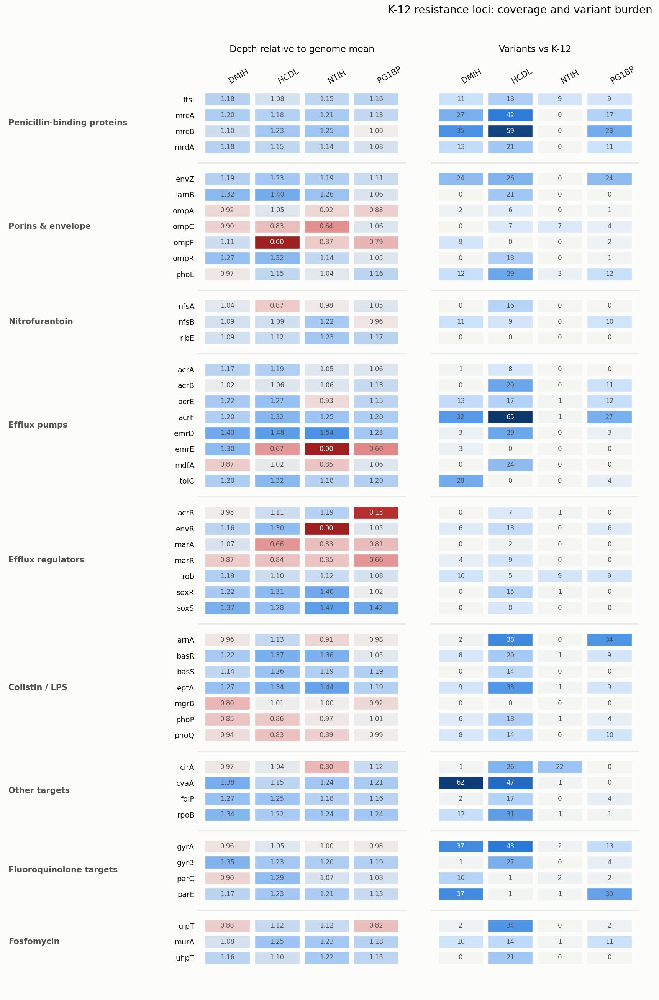
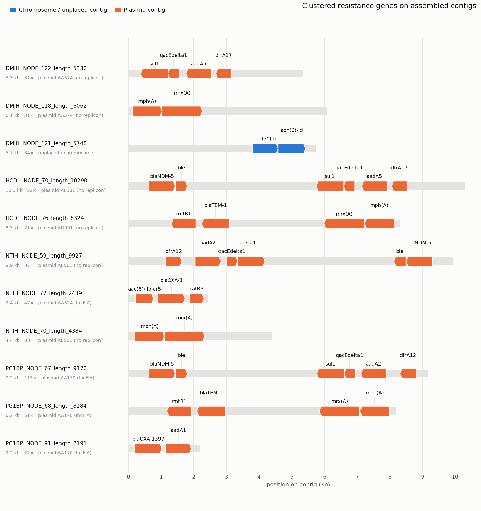

# Comparing *E. coli* Strains and Identifying Antimicrobial Resistance Genes (CESAR)
**Kenneth Ofori-Amanfo**

## Introduction
Antibiotics have played a crucial role in improving health care and human longevity. However, excessive use of antibiotics has contributed to the spread of antibiotic resistance ([Baquero et al. 2021](https://pmc.ncbi.nlm.nih.gov/articles/PMC8141826/)). A relevant situation is *Escherichia coli*, which affects healthcare systems worldwide ([Walker et al. 2022](https://pubmed.ncbi.nlm.nih.gov/36551478/)). Multi-drug resistance has spread through *E. coli* populations, causing β-lactam antibiotics, fluoroquinolones, aminoglycosides, and trimethoprim-sulfamethoxazole to be less effective. Drug-resistant strains are often associated with hospital settings and can spread through wastewater systems ([Mannan et al. 2024](https://pubmed.ncbi.nlm.nih.gov/38274770/), [Męcik et al. 2024](https://pubmed.ncbi.nlm.nih.gov/39052110/)). One of the ways antimicrobial resistance (AMR) spreads is through mobile genetic elements (MGEs) such as plasmids and integrative conjugative elements ([Partridge et al. 2018](https://pubmed.ncbi.nlm.nih.gov/30068738/)). Monitoring resistant bacteria and understanding antibiotic resistance mechanisms will improve AMR prevention measures and potentially identify novel treatment methods.

[Mannan et al. 2024](https://pubmed.ncbi.nlm.nih.gov/38274770/) have previously investigated *E. coli* strains isolated from hospital wastewater. They identified four AMR strains and profiled their genomes, including both chromosome and plasmids, using short-read and long-read sequencing. Despite their findings of AMR genes in these bacterial strains and insightful comparisons between strains, they did not share their code or publish their long-read data. My goal was to create a publicly available workflow built on widely used methods, focusing on short-read sequencing. The workflow uses the same four strains as [Mannan et al. 2024](https://pubmed.ncbi.nlm.nih.gov/38274770/), which are available via the [NCBI Sequence Read Archive](https://www.ncbi.nlm.nih.gov/sra).

This workflow, CESAR, allows for an initial general analysis of short-read sequencing data from *E. coli* isolates.


1) [`FastQC`](https://github.com/s-andrews/fastqc) provides a read quality report, and `Trimmomatic` filters low-quality bases and removes adapter sequences.
2) `Bowtie2` aligns the trimmed reads to the *E. coli* K-12 reference.
3) `mosdepth` and `BCFtools` measure coverage and call variants against K-12. These are visualized with `pyCirclize` circos plots and a heatmap of known resistance loci (porins, efflux pumps, drug targets).
4) `SPAdes` builds de novo assemblies from the trimmed reads. `QUAST` assesses assembly quality and [`FastANI`](https://github.com/ParBliSS/FastANI) compares genomic similarity between isolates.
5) `AMRFinderPlus` identifies AMR genes in the assemblies, and `MOB-suite` determines whether each one is located on a plasmid or the chromosome.

## Main Dependencies
The workflow uses Nextflow as its management system. Please install [Nextflow](https://www.nextflow.io/) to run the workflow.

Required software is obtained with [Docker](https://docs.docker.com/learn/). Please also have it installed.

- SRA Toolkit=3.2.1
- FastQC=0.12.1
- Trimmomatic=0.39
- Bowtie2=2.5.2
- SAMtools=1.18
- mosdepth=0.3.14
- BCFtools=1.25
- SPAdes=4.3.0
- QUAST=5.3.0
- FastANI=1.34
- AMRFinderPlus=4.2.7
- MOB-suite=3.1.9
- pyCirclize=1.10.1

## Compute requirements
Based on Claude Opus 5.5 estimates

Recommended requirements:
- CPUs = 8
- Memory = 16 GB

Each task is capped at 6 CPUs and 8 GB (`resourceLimits` in `nextflow.config`); raise these to make use of a larger machine.

Minimum requirements:
- CPUs = 2
- Memory = 6 GB

## Usage

Once all dependencies are installed, you can test the workflow with the instructions below, which use data from [Mannan et al. 2024](https://pubmed.ncbi.nlm.nih.gov/38274770/).

**Clone repository**
```
git clone https://github.com/KennethOfori/biof501project-CESAR.git
cd biof501project-CESAR
```

The reads for the four resistant *E. coli* isolates are downloaded by the pipeline itself (`DOWNLOAD_READS`) and saved to `data/reads/` as `<sample>_{1,2}.fastq.gz`:

| Sample | SRA run |
|--------|---------|
| PG1BP  | SRR33692911 |
| DMIH   | SRR33692910 |
| HCDL   | SRR33692909 |
| NTIH   | SRR33692908 |

If those files are already present, the download is skipped.

**Run the Pipeline**
```
nextflow run main.nf -profile local -w work -resume
```
## Results
After running the pipeline you can verify that everything worked by comparing the generated output with the contents of `expected_results/`. The full table of AMR genes found in each isolate is in `expected_results/amrfinder_summary.tsv`.

**Circos plot sample DMIH:**


**Average Nucleotide Identity:**


**Resistance Loci Heatmap:**



**Resistance Regions, Chromosomal or Plasmid:**



### AI Disclosure
This workflow uses LLM tools in its development. Code development and creation of directed acyclic graph: Claude Opus 5.5.
