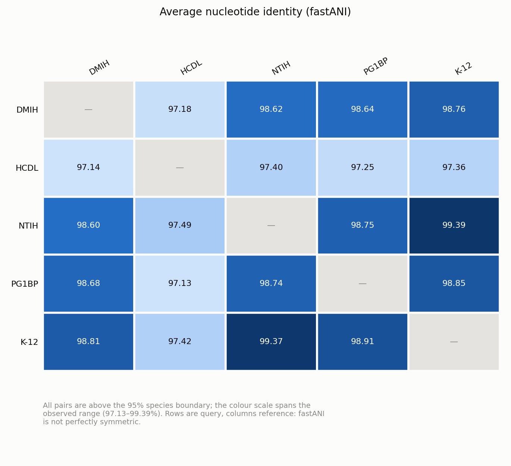

# Comparing E.Coli Species and Identifying Antimicrobial Resistance Genes (CESAR)
**Kenneth Ofori-Amanfo**

## Introduction
Antibiotics have played a cruicial role in improving health care and human longevity. However, excessive use of antibiotics have contributed to the spread of antibiotic resistance ([Baquero et al. 2021](https://pmc.ncbi.nlm.nih.gov/articles/PMC8141826/)). A relevant situation is *Escherichia coli*, which affects healthcare systems worldwide ([Walker et al. 2022](https://pubmed.ncbi.nlm.nih.gov/36551478/)). Multi-drug resistance has spread through *E. coli* populations, causing β-lactam antibiotics, fluoroquinolones, aminoglycosides, and trimethoprim-sulfamethoxazole to be less effective. Drug-resistance strains are often associated with hospital settings and can spread through wastewater systems ([Mannan et al. 2024](https://pubmed.ncbi.nlm.nih.gov/38274770/), [Męcik et al. 2024)](https://pubmed.ncbi.nlm.nih.gov/39052110/#full-view-affiliation-1)). One of the ways antimicrobial resistance (AMR) spreads are through mobile genetic elements (MGE) such as plasmids and integrative conjugative elements ([Partidge et al. 2018](https://pubmed.ncbi.nlm.nih.gov/30068738/)). Monitoring resistant bacteria and understanding antibiotic resistance mechanisms will improve AMR prevention measures and potentially identify new novel treatment methods.

[Mannan et al. 2024](https://pubmed.ncbi.nlm.nih.gov/38274770/) have previously investigated *E. coli* strains isolated from Hospital wastewater. They identified four AMR strains and profiled their genomes, including both chromosome and plasmids, using short-read sequencing and long-read sequencing. Despite their findings of AMR Genes in these bacteria strains and insightful comparisons between strains, they did not disseminate their code nor publish their long-read data. My goal was to create a workflow that is accessible, focusing on short-read sequencing, and publicly available. The workflow uses the same four strains that [Mannan et al. 2024](https://pubmed.ncbi.nlm.nih.gov/38274770/) used that are available via [NCBI Sequence Read Archive](https://www.ncbi.nlm.nih.gov/sra)

This workflow, CESAR, allows for intial general analysis of short-read sequencing data *E. coli* species.

1) Use `FASTQC` to provide a read quality check report. Use `Trimmomatic` to filter low-quality bases and remove adapter sequences.
2) `Bowtie2` to align reads to the *K-12 E. coli* reference.
3) `pycirclize` to create visualizations for *K-12* comparisons and identify Resistant loci with `AMRFinderPlus`.
4) `SPAdes` uses trimmomatic output reads to create de novo assemblies to then compare genomic similarities with `FastANI`
5) Lastly `MOB-suite` identifies AMR and determines if they are on a plasmid

## Main Dependencies
The workflow uses Nextflow as its management system. Please install [Nextflow](https://www.nextflow.io/) to run the workflow.

Required software is obtained with [Docker](https://docs.docker.com/learn/). Please also have it installed.

- SRA Toolkit=3.2.1
- FastQC= 0.12.1
- Trimmomatic=0.39
- Bowtie2=2.5.2
- SAMtools=1.18
- mosdepth=0.3.14
- BCFtools=1.25
- SPAdes=4.3.0
- QUAST=5.3.0
- FastANI=1.34
- AMRFinderPlus=4.2.7 
- MOB-suite=3.1.9
- pyCirclize= 1.10.1

## Compute requirements
Based on Claude Opus 5.5 estimates

Recommended requirements:
- CPUs = 8
- Memory = 16

Minimum requirements:
- CPUs = 2
- Memory = 6 GB

## Usage


Once all dependencies are installed, you can test the workflow by following the following instructions which provides data from [Mannan et al. 2024](https://pubmed.ncbi.nlm.nih.gov/38274770/).

**Clone repository**
```
git clone https://github.com/KennethOfori/biof501project-CESAR.git
cd biof501projects-CESAR
```

The reads for the four resistant *E. coli* isolates are downloaded by the pipeline itself (`DOWNLOAD_READS`) and saved to `data/reads/` as `<sample>_{1,2}.fastq.gz`:

| Sample | SRA run |
|--------|---------|
| PG1BP  | SRR33692911 |
| DMIH   | SRR33692910 |
| HCDL   | SRR33692909 |
| NTIH   | SRR33692908 |

If those files are already present, the download is skipped.

**Run the Pipeline**
```
nextflow run main.nf -profile local -w work -resume
```
## Results
After running the pipeline you can verify that everything worked by comparing the generated output with the contents of `expected_results/`

**Circos plot sample DMIH:**


**Average Nucleotide Identify:**


### AI Disclosure
This workflow uses LLM tools in its development. Code development and creation of directed acyclic graph: Claude Opus 5.5.
